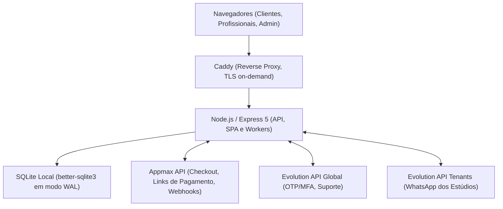

# Arquitetura Atual — Lash Designer 5.12.14

Este documento descreve a arquitetura técnica, os contratos de domínio e os fluxos operacionais consolidados na versão **5.12.14** (incluindo o hotfix visual **5.12.13**).

## Topologia Efetiva

O frontend é uma SPA React 19 compilada com Vite em `dist/client/`, servida estaticamente pelo Express com fallback para `index.html`. O backend Node.js é compilado em `dist/server/index.js` e gerenciado pelo systemd via `lashdesigner.service`. Não há SSR.

O banco de dados SQLite opera localmente na máquina com `better-sqlite3` em modo WAL (`journal_mode = WAL`), foreign keys estritas e timeout de bloqueio de 5000ms.

## Organização e Módulos do Sistema

### 1. Frontend
- `src/app/AppRoutes.tsx`: Roteador principal baseado em domínio/host, discriminando acesso à Landing Page, Painel Admin, Central de Suporte, Portal da Cliente e Booking Público.
- `src/features/`: Módulos de domínio desacoplados:
  - `admin/`: Painel de controle da administradora (`AdminApp.tsx`, roteamento por tabs com suporte a query params `view=team` e `view=support`).
  - `dashboard/`: Painel analítico e operacional (`AdminDashboard.tsx`) com marcadores de atividade de geometria rígida (`flex: "0 0 12px"`, proporção 1:1 e `overflowWrap: "anywhere"`).
  - `team/`: Módulo de equipe desacoplado (`AdminTeam.tsx`, `ProfessionalEditor.tsx`, `TeamHours.tsx`, `ProfessionalTimeOff.tsx`, `ProfessionalAccess.tsx`). Cadastro em 3 etapas, grade de horários, folgas por timezone e gestão de acesso STAFF. O launcher flutuante da Luma é suprimido nesta aba.
  - `services/`: Catálogo de procedimentos e precificação (`AdminServices.tsx`), estritamente desacoplado da gestão de pessoas (legado `ProfessionalManager.tsx` removido).
  - `booking/`: Fluxo público de agendamento em 4 etapas com prioridade mobile (`BookingPage.tsx`).
  - `staff/`: Gestão de equipe multi-profissionais e controle de escala (`StaffPage.tsx`).
  - `support/`: Central de suporte humanizada (`SupportCenter.tsx`, `SupportComposer.tsx`) com validação inline imediata em português, campos avançados recolhidos, balões visuais e notas internas protegidas.
  - `client/`: Portal da cliente com autenticação passwordless por WhatsApp.
- `src/components/`: Componentes transversais:
  - `LandingCheckout.tsx`: Modal e formulário de checkout público para planos por equipe.
  - `BillingCenter.tsx`: Gestão de assinatura do estúdio e extrato de indicações.
  - `WhatsAppCenter.tsx`: Conexão de instâncias WhatsApp e disparo de mensagens.
  - `LumaConversation.tsx`: Assistente de inteligência artificial Luma.

### 2. Backend & Roteamento Modular
A montagem de rotas em `server/index.ts` é dividida em registradores de domínio:
- `server/routes/registerPlatformRoutes.ts`: Rotas públicas (`/api/health`, `/api/ready`), autenticação de sessão (`/api/auth/*`), portal da cliente, documentação legal e console DEV.
- `server/routes/registerBillingAssistantRoutes.ts`: Onboarding público (`/api/onboarding/*`), checkout Appmax, webhook InfinitePay, rotas da Luma AI e webhooks Evolution.
- `server/routes/registerTenantRoutes.ts`: Rotas protegidas por estúdio e papel (`ADMIN`/`STAFF`):
  - Dashboard, agenda e calendário;
  - Clientes e histórico de atendimentos;
  - Catálogo de serviços e precificação;
  - Fluxo financeiro e conciliação;
  - Gestão de profissionais e escalas (`adminProfessionalsRoutes.ts`): validação Zod contra sobreposição de horários no mesmo dia (`hoursSchema.superRefine`), proteção da conta ADMIN contra suspensão via endpoint STAFF e retorno de `businessHours` e `timezone` do estúdio;
  - Acesso de equipe e convites (`professionalAccessRoutes.ts`);
  - WhatsApp Center e campanhas;
  - Central de Suporte (`supportRoutes.ts`);
  - Programa de indicações (`referralRoutes.ts`).

### 3. Serviços de Domínio e Infraestrutura
- `server/appmax.ts`: Cliente HTTP para API da Appmax. Cria links de pagamento via `/v1/payment-link` utilizando array plano `payments: ["creditcard", "pix"]` (nunca aninhado).
- `server/appmaxBillingService.ts`: Orquestração de checkout, reservas de indicação, confirmação de pedidos e conciliação periódica de cobranças pendentes e estornadas.
- `server/appmaxReferralService.ts`: Mecanismo financeiro de cotação pública, validação de tokens, deduções de dívidas de estorno e bloqueio anti-autoindicação.
- `server/support/`: Subsistema de suporte:
  - `supportService.ts`: Criação e transições de tickets com protocolos atômicos (`SUP-YYYYMMDD-XXXX`).
  - `supportStorage.ts`: Armazenamento de anexos binários diretamente no SQLite com integridade referencial.
  - `supportNotifications.ts`: Notificações persistentes consultadas por polling a cada 20-25s.
- `server/customerAppointmentService.ts`: Motor transacional de agendamento, validação de conflitos e slots de disponibilidade.
- `server/appointmentAutomationRuntime.ts`: Agendamento de lembretes e mensagens operacionais via WhatsApp.

## Banco de Dados & Migrações

O esquema é versionado em `server/migrate.ts` e executado automaticamente na inicialização do serviço:
- `Migração 43`: Distinção de `suspension_reason` ('APPMAX' para inadimplência vs bloqueio manual por segurança). No modo de recuperação, estúdios suspensos mantêm acesso restrito ao Admin para regularização de assinatura e tickets de suporte.
- `Migração 44`: Estrutura da Central de Suporte: tabelas `support_tickets`, `support_messages`, `support_attachments` e `support_notifications`.
- `Migração 45` (`server/appmaxReferralSchema.ts`):
  - Adição de `gross_amount_cents`, `discount_percent` e `referral_redemption_id` em `appmax_checkout_intents`.
  - Tabela `appmax_referral_memberships`: vincula estúdios criados via indicação.
  - Tabela `appmax_referral_debts`: registra dívidas percentuais geradas por estorno de assinaturas indicadas.
  - Tabela `appmax_referral_debt_allocations`: mapeia o abatimento atômico de dívidas em renovações com desconto.

## Modelo de Cobrança e Proteção Contra Fraudes

1. **Planos Oferecidos**:
   - `TEAM_3` (até 3 profissionais): R$ 74,90/mês
   - `TEAM_6` (até 6 profissionais): R$ 99,90/mês
   - `TEAM_15` (até 15 profissionais): R$ 149,00/mês
2. **Desconto de Indicação**: 15% na primeira mensalidade para a convidada.
3. **Recompensa por Indicação**: 10% de crédito acumulável na renovação da indicadora, limitado ao teto de 30%.
4. **Fingerprint Criptográfico (`quoteFingerprint`)**: Hash SHA-256 gerado a partir do valor bruto, valor líquido, percentual de desconto e token de indicação. Garante que o valor exibido na cotação pública seja idêntico ao contratado no checkout.
5. **Anti-Autoindicação**: Validação cruzada por telefone normalizado em E.164, e-mail e tenant ID (`appmaxBilling.validateReferral`).
6. **Compensação Automática de Estornos**: Se uma indicada cancelar/estornar após a indicadora ter utilizado o benefício, o valor é lançado como débito percentual em `appmax_referral_debts` e compensado em indicações futuras, sem cobranças inesperadas no cartão da usuária.
