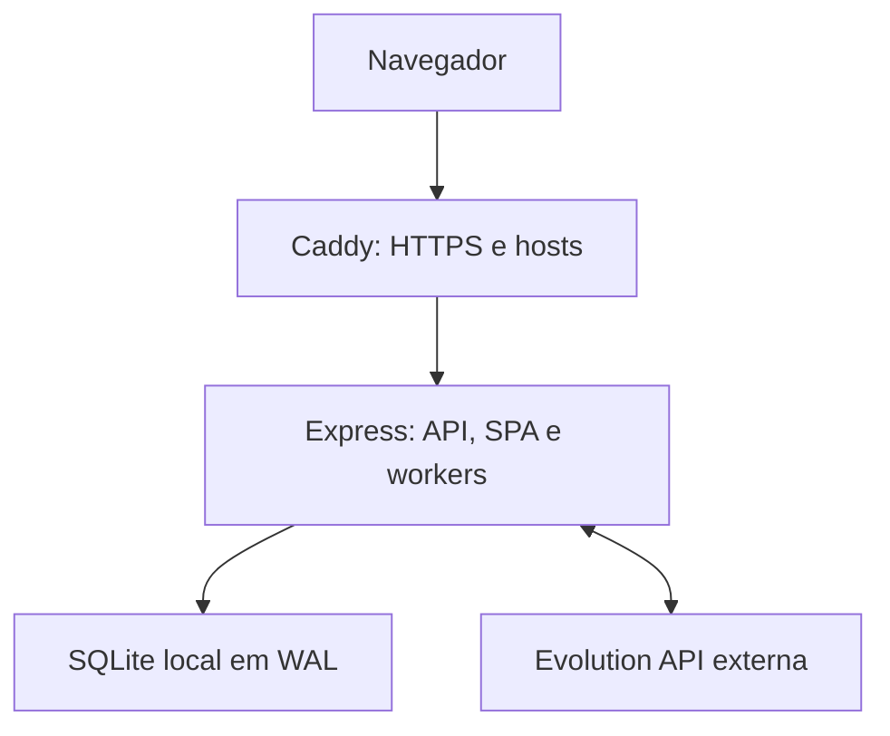

# Arquitetura atual — Lash Designer 5.12.12

Este documento descreve o pacote entregue. A referência histórica anterior foi preservada em `docs/ARCHITECTURE_5_6_LEGACY.md`; seus números de linhas e caminhos antigos não devem orientar novas alterações.

## Topologia efetiva

O frontend React/Vite é uma SPA compilada em `dist/client`, servida pelo Express. Não há SSR. `deploy/lashdesigner.service` inicia um processo Node com `dist/server/index.js`; o banco e a mídia privada ficam locais à aplicação. Workers de confirmação, envio, conciliação e manutenção são runtimes gerenciados pelo mesmo processo. Evolution é configurada por URL; o ZIP não instala o servidor Evolution nem implementa separação física em duas VPS.

A topologia de dois servidores descrita no relatório externo é uma proposta, não prova de implantação. Dimensionamento para 1.000 estúdios exige ensaio de carga e métricas. O pacote atual não deve ser replicado como múltiplos gravadores sobre um SQLite compartilhado em rede.

## Organização do código

- `src/app/AppRoutes.tsx`: roteamento por host/estúdio e carregamento das áreas.
- `src/features`: áreas de autenticação, administradora, DEV, profissional, cliente, serviços, calendário, financeiro, configurações e suporte.
- `src/components`: componentes compartilhados, WhatsApp Center, billing, Luma e setup.
- `server/index.ts`: composição dos serviços e ciclo de vida.
- `server/routes/registerPlatformRoutes.ts`, `registerBillingAssistantRoutes.ts`, `registerTenantRoutes.ts`: montagem ordenada dos routers.
- `server/customerAppointmentService.ts`: disponibilidade e criação de reserva. Reserva, contato da inbox e jobs são transacionais.
- `server/clientConversationSync.ts`: sincronização do contato por estúdio/telefone sem mensagem ou opt-in artificial.
- `server/appointmentAutomationRuntime.ts`: jobs idempotentes e mensagens, incluindo contexto da profissional.
- `server/support`: contratos, transações, estados, visibilidade, anexos, notificações e idempotência de tickets.
- `server/appmax.ts`, `appmaxBillingService.ts`, `appmaxWebhookRuntime.ts`: comunicação e verificação no provedor, intenções e conciliação.

## Acesso e dados

Sessões opacas revogáveis no servidor. ADMIN e STAFF pertencem ao estúdio; STAFF vê sua agenda e seus próprios tickets. CLIENT acessa seus agendamentos, profissional e preferências. DEV exige o host DEV para rotas sensíveis e suporte global.

O esquema permanece na migração 44. Tickets têm protocolo global e escopo de leitura por estúdio/papel. Notas usam `visibility=INTERNAL` e não são expostas a ADMIN/STAFF. Imagens de suporte ficam no banco com download autenticado; reencode não oculta automaticamente dados visíveis na captura.

Notificações são persistentes com consultas periódicas, não WebSocket/push instantâneo. O sino consulta a cada 25 s; a central, a cada 20 s, quando visível. Configurações DEV e administração de usuários só são montadas na aba correspondente.

## Oferta e cobrança

Três planos mensais por estúdio: TEAM_3 R$ 74,90; TEAM_6 R$ 99,90; TEAM_15 R$ 149,00. Disponibilidade do gateway controla a contratação, não os preços publicados. Valores históricos não são reescritos.

Appmax verifica vínculo link/pedido e valor pago igual ao da intenção antes de ativar. O ambiente é configurável; testes locais não certificam uma cobrança real. Transições comerciais durante contratos ativos continuam fora do checkout atual.

## Deploy e validação

`DEPLOY_VPS.md`, `deploy/Caddyfile` e serviços systemd definem o deploy do pacote. Caddy autoriza hosts para TLS individualmente por endpoint local. Backup consistente inclui o SQLite; mídia privada externa ao banco segue sua política própria.

Executar `npm run check` e os cenários de navegador/HTTP documentados em `docs/RELEASE_5_12_10.md`. Comparar modificações feitas diretamente na VPS antes de instalar. Relatório de QA deve distinguir cliente com fixtures, HTTP real local e homologação com provedores externos.

Indicações: `appmaxReferralService.ts` aplica desconto inicial e reserva créditos com teto de 30%; `appmaxBillingService.ts` confirma valor/pedido com o provedor e liquida o ledger na transação. Migração 45 preserva o histórico e registra compensações por estornos. `teamDiscountsAvailable` depende da disponibilidade do checkout Appmax configurado.
